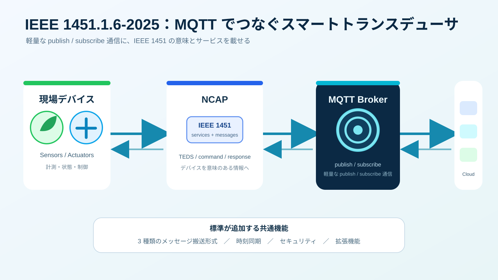

IEEE 1451.1.6-2025は、センサーやアクチュエータが扱うIEEE 1451メッセージを、IoTで広く使われるMQTTで運ぶ方法を定めたIEEE規格です。当研究室は、2018年の策定提案から2026年の発行まで、規格づくりと実装の両面に取り組んできました。

## 規格情報

| 項目               | 内容                                                                                                                                                           |
| ------------------ | -------------------------------------------------------------------------------------------------------------------------------------------------------------- |
| 規格番号           | IEEE 1451.1.6-2025                                                                                                                                             |
| 正式名称           | IEEE Standard for a Smart Transducer Interface for Sensors, Actuators, and Devices—Message Queue Telemetry Transport (MQTT) for Networked Device Communication |
| 種別               | Standard                                                                                                                                                       |
| ワーキンググループ | MQTT Interface Working Group                                                                                                                                   |
| 議長               | 西宏章（Hiroaki Nishi）                                                                                                                                        |
| PAR申請            | 2018年3月（当時のプロジェクト番号はP21451.1.6）                                                                                                                |
| 承認               | 2025年6月19日（IEEE SA Standards Board）                                                                                                                       |
| 発行               | 2026年2月6日                                                                                                                                                   |
| 公式ページ         | [IEEE Standards Association](https://standards.ieee.org/ieee/1451.1.6/11619/)                                                                                  |

## 規格の概要

IoTの現場では、多数のセンサー、制御機器、ゲートウェイ、クラウドサービスなどが用いられます。機器ごとにデータの表し方や呼び出し方が異なると、接続のたびに個別の開発が必要になり、システムの拡張や長期の運用が難しくなります。

IEEE 1451は、センサーやアクチュエータを機種に依存せずネットワークから扱うための規格群です。IEEE 1451.1.6は、その枠組みのメッセージを、軽量なPublish/Subscribe型のプロトコルであるMQTTで伝送する方法を定めています。これにより、MQTTを使用する既存のIoT基盤への機器の組み込みが容易になります。

この規格は主に次の内容を定めています。

- IEEE 1451メッセージをMQTTで運ぶための通信モデル
- 用途に応じた三つのメッセージ形式
- 機器とアプリケーションの間のメッセージ交換
- 時刻同期、セキュリティ、拡張に関する考え方
- ネットワーク対応アプリケーションプロセッサと、トランスデューサ側の機器との連携

## 標準化活動の歩み

開発時のプロジェクト番号はP21451.1.6で、2018年3月にPAR（Project Authorization Request）を申請しました。その後、IEEE 1451ファミリーの番号体系にあわせてP1451.1.6へ改められました。

規格は、ワーキンググループに参加した各国の研究者や技術者が、議論と投票を重ねて合意した成果です。西宏章教授は議長として、その進行を担いました。2025年6月に承認され、2026年2月に発行されています。

## 当研究室での実装と実験

当研究室は、規格案を書くだけでなく、策定中の段階から規格案に沿ったセンサーネットワークを実装し、評価してきました。その結果を規格の議論へ持ち帰っています。

IEEE産業エレクトロニクス学会（IES）は、国際会議にあわせて相互接続試験イベントのPlugfest（Standards and Interoperability Plugfest）を開いています。当研究室は2020年から2022年まで参加し、規格案に基づくデモを行いました。

応用例として、温室の環境制御があります。IEEE 1451に準拠したセンサーで温度を計測し、送風を制御して、温度のむらを抑えるシステムを構築しました。

近年は、NIST（米国国立標準技術研究所）の研究者と共同で、IEEE 1451を使ったデジタルツインにも取り組んでいます。

## 論文・デモ

| 年   | 内容                                                                                                                                                                                                     |
| ---- | -------------------------------------------------------------------------------------------------------------------------------------------------------------------------------------------------------- |
| 2020 | IECON 2020のPlugfestで、IEEE P1451.99のデモを実施                                                                                                                                                        |
| 2021 | IECON 2021で「Time Synchronization of IEEE P1451.0 and P1451.1.6 Standard-based Sensor Networks」を発表。ISIE 2021とIECON 2021のPlugfestで、IEEE P1451.1.6のデモを実施                                   |
| 2022 | IECON 2022で「Implementation of IEEE P1451.0 and P1451.1.6 Standards-based Sensor Network」を発表。同会議のPlugfestでデモを実施                                                                          |
| 2023 | IECON 2023で「Temperature Monitoring and Airflow Control System for Balancing the Greenhouse Environment Using IEEE 1451 Standards」を発表                                                               |
| 2024 | IECON 2024で「Security for IEEE P1451.1.6-Based Sensor Networks for IoT Applications」を発表（Best Presentation Recognition）                                                                            |
| 2025 | IECON 2025で「IEEE 1451-based Digital Twin Framework for Real-Time Monitoring and Control of Smart Homes」を発表（NISTとの共著）                                                                         |
| 2026 | ISIE 2026で「Digital Twin-based Interoperability Testing Method for IEEE 1451 IoT Smart Transducers」を発表（NISTとの共著）。同会議で「Interoperable PMV Prediction using IEEE 1451.1.6 and MQTT」を展示 |

業績の全体は[業績一覧](/publications/)をご覧ください。

## IEEE 2992との関係

IEEE 1451.1.6が機器のデータを運ぶ方法を定めるのに対し、IEEE 2992-2025はスマート農業のデータを表し、交換し、処理する方法をまとめた推奨プラクティス（Recommended Practice）です。たとえば温室では、温湿度、CO₂濃度、日射、機器の状態などのデータが継続的に生まれます。当研究室は、センサー層からデータを運ぶ仕組みと、上位層でデータの意味や構造をそろえる仕組みを、一つの流れとして研究しています。

両者は独立したIEEE規格です。ここで述べた関係は当研究室の研究上の位置づけであり、規格どうしが公式に一体であることを示すものではありません。

本ページは規格の概要を紹介するもので、要求事項の正式な解釈にはIEEEから発行された規格本文を参照してください。
