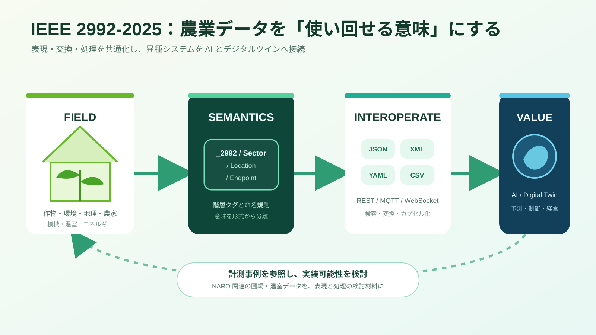

IEEE 2992-2025は、スマート農業のデータの表現、交換、処理に関する推奨プラクティス（Recommended Practice）です。

## 規格情報

| 項目                       | 内容                                                                                         |
| -------------------------- | -------------------------------------------------------------------------------------------- |
| 規格番号                   | IEEE 2992-2025                                                                               |
| 正式名称                   | IEEE Recommended Practice for Data Expression, Exchange, and Processing in Smart Agriculture |
| 種別                       | Recommended Practice（推奨プラクティス）                                                     |
| ワーキンググループ         | DEEP-SA                                                                                      |
| 議長                       | 西宏章（Hiroaki Nishi）                                                                      |
| 副議長                     | Janaka Wijekoon                                                                              |
| PAR承認                    | 2021年5月21日                                                                                |
| 承認                       | 2025年9月10日                                                                                |
| 発行                       | 2026年2月20日                                                                                |
| 公式ページ                 | [IEEE Standards Association：IEEE 2992-2025](https://standards.ieee.org/ieee/2992/10614/)    |
| ワーキンググループのページ | [sagroups.ieee.org/2992](https://sagroups.ieee.org/2992/)                                    |

## 規格の概要

この推奨プラクティスは、スマート農業のデータを組織やシステムの違いを越えて扱うために、データ形式、タグ、命名、階層構造、転送、保存、検索、処理についての考え方を示します。

農業のデジタル化では、圃場や温室の環境データ、作物の生育情報、作業履歴、機器の状態、エネルギー使用量など、多様なデータを扱います。CSVやJSONのように保存形式がそろっていても、項目名、単位、階層、識別方法が違えば、データを組み合わせるたびに変換が必要です。IEEE 2992は特定のメーカーやデータ形式に依存せず、システムが違ってもデータの意味が通じるような設計方法を定めています。機器を入れ替えたり、新しい分析サービスを加えたりしても、データを再利用しやすくすることが目的です。

## 想定される利用場面

- 温室や圃場に置いた複数メーカーのセンサーのデータを統合する
- 農場、地域、研究機関、クラウドの間でデータを受け渡す
- データを匿名化・集約しながら、階層的に共有する
- AIの学習やデジタルツインに使える、一貫したデータセットを整える
- 環境制御、エネルギー管理、作業支援のサービスを連携させる
- 長期間の研究データを、機器を更新したあとも使える形で保存する

## 当研究室の取り組み

IEEE 2992は、当研究室が農研機構（NARO）と進めてきたスマート農業の研究をもとにしています。温室で計測したデータを規格に沿った階層構造とタグで表し、変換・蓄積から匿名化・集約までを行うデータ基盤を検討しています。現場で必要になるデータの階層、タグ、通信、変換、蓄積の方法を考え、抽象的な仕様を実装できる形に落とし込むことが狙いです。この考え方を使った情報表現と利用例は、2024年に論文として発表しました。

## AI・デジタルツインへの展開

AIの学習にデータを使うには、どこで、何を、どの単位で、どの条件で測ったのかがわかり、異なるデータを機械的に結合できなければいけません。IEEE 2992の共通表現により、学習データの履歴や意味を保ち、モデルの再利用や比較をしやすくします。実世界の状態を仮想空間に再現するデジタルツインでも、センサー、設備、作物、場所、時間を同じ規則で結びつけておく必要があります。

## 国際的な合意形成

IEEE 2992のPARは2021年5月に承認され、同年に策定を始めました。西宏章教授が議長、Janaka Wijekoon氏が副議長を務めました。

2021年にはNAROとIEEE SAの共同ワークショップで、スマート農業のデータ表現・交換・処理について講演しました。NAROの開催報告によると、このワークショップには48か国から400人を超える事前登録がありました。2022年にもNARO・IEEE SAのワークショップで講演しています。2026年9月には、韓国で開かれたIEEE SAとETRIのジョイントワークショップと、IEEE SAのAIに関する国際会議で、IEEE 2992を紹介しました。

## 論文・講演

| 年   | 内容                                                                                                                                                                                               |
| ---- | -------------------------------------------------------------------------------------------------------------------------------------------------------------------------------------------------- |
| 2022 | NARO・IEEE SA共同ワークショップ（2022年10月13日、東京）で「Practice of Standardization Activities in IEEE SA - IEEE P2992 Data Expression, Exchange, and Processing in Smart Agriculture -」を講演 |
| 2022 | IES Standards / InterOP Plugfest（IECON 2022、ブリュッセル）で「IEEE P2992 – Data Expression, Exchange, and Processing in Smart Agriculture」を講演                                                |
| 2023 | IEEE SA & NARO Presidential Meetingで「Progress on IEEE P2992」を講演（7月24日）                                                                                                                   |
| 2024 | IECON 2024（シカゴ）で「Integrated Information Representation Using IEEE P2992 and Its Application Use Cases」を発表                                                                               |
| 2026 | UTA Café EU–Japan Webinar Session 2（9月1日）で「AI-Ready Smart Agriculture with IEEE 2992-2025: From Interoperable Data to Digital Twins」を講演                                                  |
| 2026 | IEEE SA & ETRI Joint workshop Emerging AI Technologies & Global Standards（9月15日、ETRI、韓国・大田）で「AI-Ready Smart Agriculture with IEEE 2992-2025」を講演                                   |
| 2026 | The 26th IEEE SA International Conference on Artificial Intelligence（9月16日、韓国・ソウル）で「AI-Ready Smart Agriculture with IEEE 2992-2025 From Interoperable Data to Digital Twins」を講演   |

本ページは規格の概要を紹介するもので、推奨事項の正式な解釈にはIEEEから発行された規格本文を参照してください。
