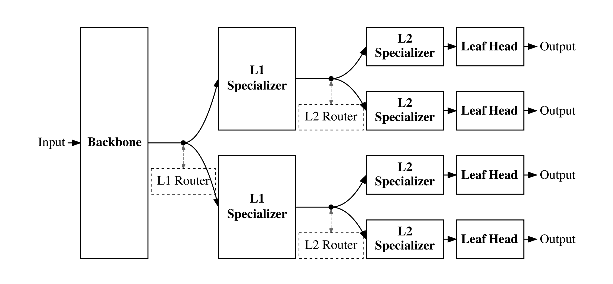
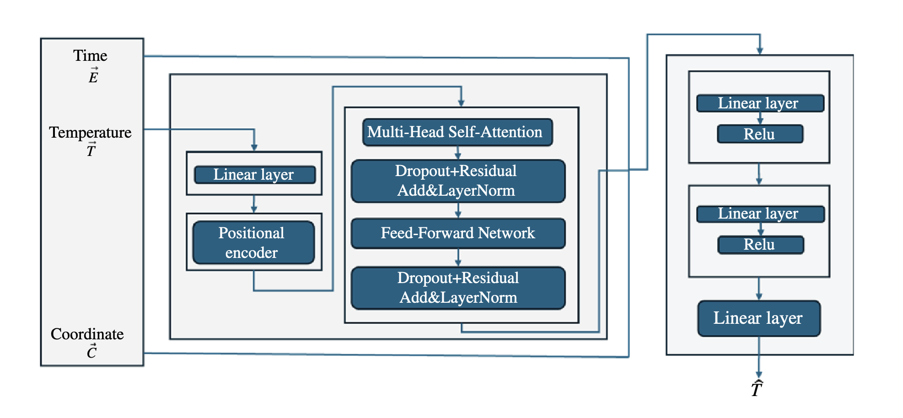
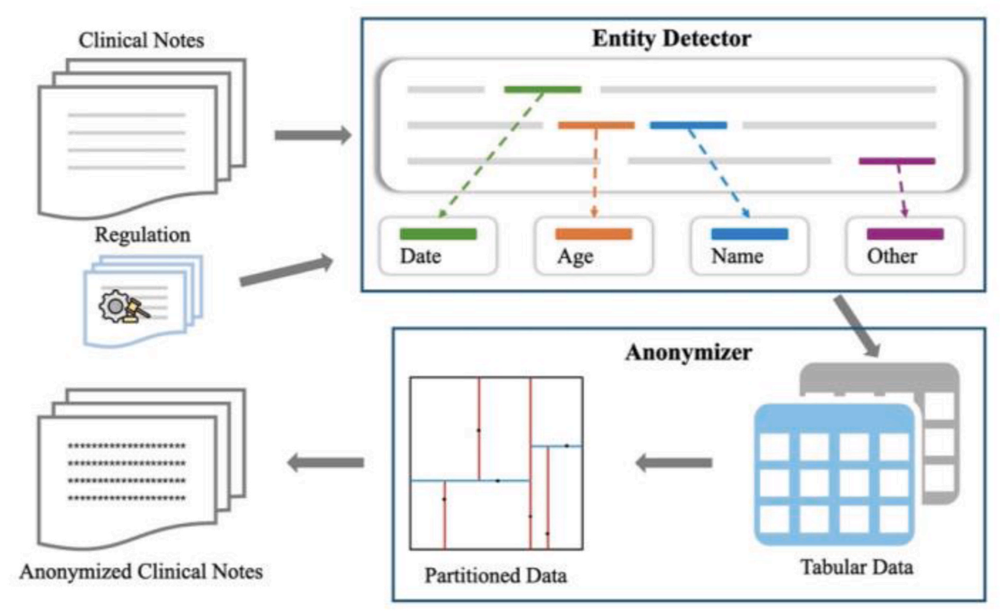
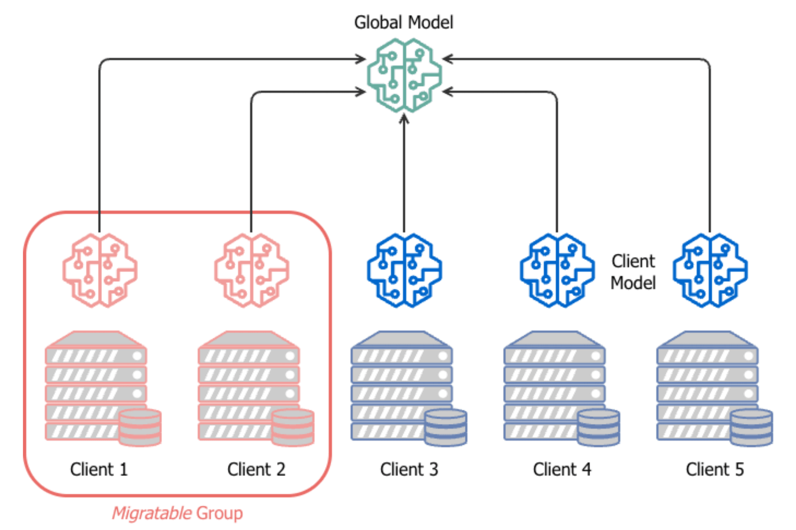

当研究室は深層学習を使って多様な分野の課題を解決し、実社会で使える効率的なAI技術の実現を目指しています。実際の現場では、端末のメモリや計算能力、個人情報の扱い、端末ごとの性能差といった制約があり、精度を上げるだけでは使えません。そこでこうした制約を前提にした手法を研究しています。

## エッジで動く軽量なモデル

メモリ容量の小さいエッジ端末ではニューラルネットワークの計算だけでなく、推論のたびに重みを読み込む転送コストが処理を遅くします。入力によらずモデル全体を動かすかぎり、この負担は避けられません。

そこで当研究室は学習済みモデルを共有バックボーン、階層ルータ、専門化した複数の葉からなる二分木に再構成するSigma-Branchを開発しました。活性値に基づいて重みを各枝に割り当て、入力ごとに根から葉までの経路を一つだけ実行します。モデル全体のパラメータは保持したまま、一回の推論で使う有効パラメータを減らす仕組みです。

この結果、一回の推論で使う有効パラメータを58～60％削減できました。画像認識と三次元点群認識のどちらでも、精度の低下は1.72ポイント以内にとどまっています。

## 室内の温度分布の推定

空調で快適性と省エネルギーを両立するには、人のいる場所を含めた室内全体の温度を知る必要があります。しかし、固定センサでは測れない地点が残り、数値流体解析は計算の負荷が大きくなります。

そこで当研究室は位置符号化とAttention機構を全結合ニューラルネットワークに組み込んだAST-Modelを開発しました。136個のセンサから2秒間隔で集めた温度、時刻、三次元座標を入力にして、過去10分間の変化から、センサのない地点も含めた温度分布を推定します。

平均絶対誤差は0.15℃でした。センサが少ない場合や学習データが限られる場合でも、精度は保たれています。エッジ端末では1サンプルあたり約3.17ミリ秒で推論できるため、リアルタイムの空調制御への応用が期待できます。

## 医療記録の匿名化

自由記述の電子医療記録には、患者を特定できる情報が含まれます。研究に活用するためには、データの有用性を保ちながらプライバシーを守らなければなりません。

当研究室は匿名化を二つの段階に分けました。まずBERT系モデルまたは大規模言語モデルで、氏名・年齢・住所などの機微情報を検出します。次に、数値やカテゴリ属性の階層関係を考慮した $k$-匿名化で、特定につながる情報を一般化します。

機微情報の検出では、F1値が大規模言語モデルで95％超、BERT系モデルでも約90％でした。匿名化では、規則ベースの手法が情報の損失を抑えました。LoRAによる軽量な追加学習とローカルでの実行にも対応するため、利用環境に応じて、精度・プライバシー・計算資源のバランスを選べます。

## 分散学習の効率化

性能の異なる端末が協調して学ぶ分散学習では、処理の遅い端末（ストラグラー）が全体の同期を待たせます。従来の方法で遅い端末を除外すると、その端末だけが持つ有用なデータも学習に使えなくなります。

そこで当研究室は、データの共有が許可された信頼領域で、ストラグラーから高速な端末へデータを動的に移す方法を研究しました。損失勾配と損失の急増から学習難易度指標（LDI）を求め、学習への寄与が大きいバッチから優先して移します。

FEMNISTを使った評価では、FedAvgの44.99％の時間で学習を終え、平均精度も1.23ポイント向上しました。負荷が変動する環境でも約3.2倍に高速化しています。遅い端末のデータを捨てずに、学習の効率を高められます。
