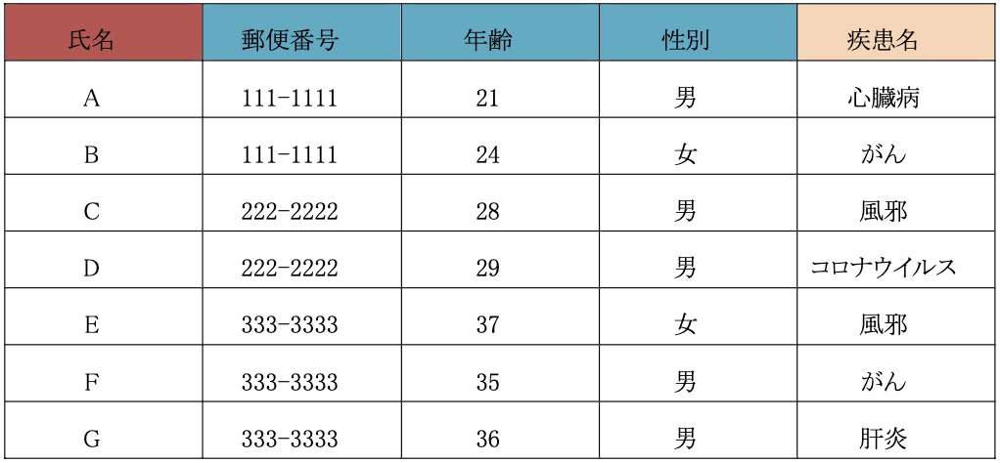
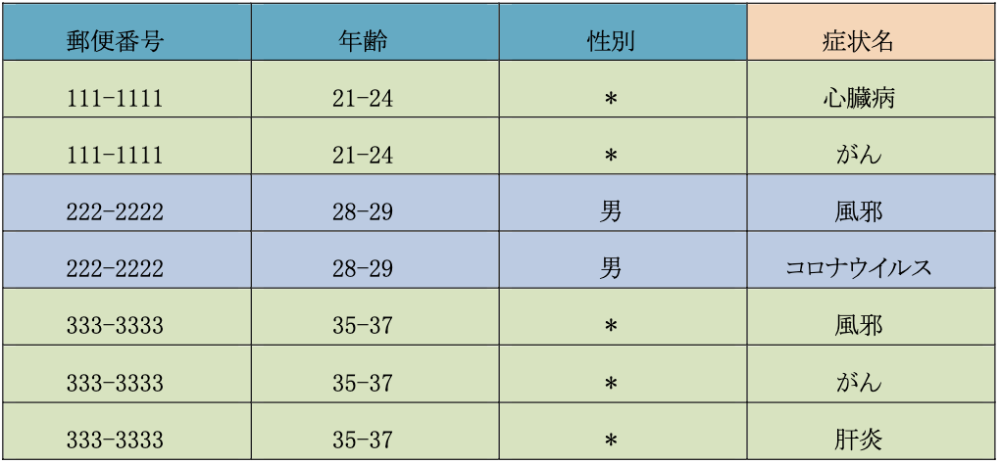
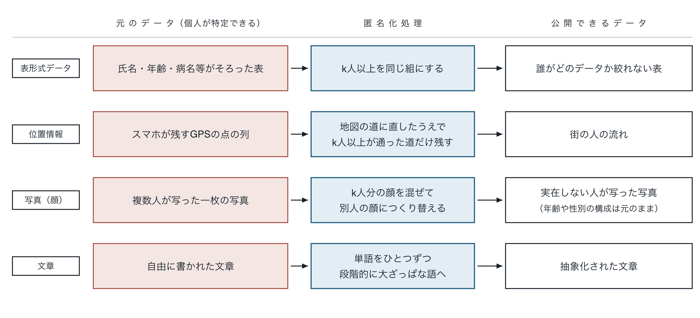

## 個人情報の匿名化

スマートシティなどで集められるビッグデータは、二次利用の価値が高い一方、そのまま公開すると個人が特定される恐れがあります。匿名化は、誰のデータか分からなくしつつ、二次利用には使える形で残すための加工技術です。

## 匿名化の仕組み

氏名を消すだけでは不十分で、年齢・性別・郵便番号などの組み合わせから個人が特定される可能性があります。そこでデータの項目を、単体で個人を特定できる識別子、組み合わせると特定できる準識別子、分析に必要で残したい機密属性の三つに分け、識別子は削除、準識別子は大ざっぱな値に置き換え、機密属性はそのまま残します。同じ特徴を持つ人が必ず$k$人以上いる状態をつくる$k$-匿名化や、数値データにノイズを加える差分プライバシーなどの手法があります。

- 匿名性を上げるほどデータの有用性は下がるため、両者のつまみをどう制御するかが課題
- 構造化された表形式データで確立された考え方を、移動経路・画像・文章といった非構造化データへ拡張

## 扱うデータと処理の方法

**移動経路や**画像、文章のように、項目に区切られていないデータは、そのままでは「年齢を30代にまとめる」といった加工ができません。そこでまず、データを匿名化できる形に変換することから始めます。

- **移動経路**：スマートフォンが残すのは飛び飛びの点の列です。これを地図上の道に対応づけ、交差点で区切った区間の単位に置き換えます。点と点の間をどう通ったかは、過去に多くの人が実際に通った履歴から推定します。こうすると人数を数えられるようになり、一定時間内にk人以上が通った区間だけを公開できます。一人しか通らなかった道は公開しないため、個人の足取りは追うことができません。
- **顔画像**：顔画像は、画像生成モデルを用いて、その人らしさを表す数値の並びに変換します。数値になれば、複数人分を混ぜ合わせて平均的な顔をつくったり、年齢だけを動かしたりできます。k人ずつの組に分けて組ごとに同じ顔をつくり、元の写真に貼り戻すことで、誰であるかは分からないまま、年齢や性別の構成は元のまま残ります。
- **文章**：文章では、特定につながる情報が特定の単語ではなく全体に散らばっています。そこで語ごとに「24歳→20代→成人」というように、段階的に大ざっぱにしていく階段をあらかじめ用意し、必要な段まで置き換えます。どこまで置き換えれば安全と言えるのかは、文章の意味の近さを測る言語モデルを用いて評価します。

## 機械学習とハードウェアによる高速化

画像や文章のような非構造化データを匿名化できる形に変換する部分では、機械学習が中心的な役割を果たします。顔を数値の並びに変換すること、文章どうしの意味の近さを測ることは、いずれも大量のデータから学習することで初めて可能になります。私たちは、こうした学習済みのモデルを匿名化の処理に組み込むだけでなく、匿名化そのものを行うモデルの構築にも取り組んでいます。

一方で、データが絶えず流れ込むスマートシティでは、処理の速さも課題になります。匿名化には時間のかかる計算が含まれ、ソフトウェアによる処理では、届いたデータを処理し終える前に次のデータが届いてしまいます。そこで移動経路の匿名化では、処理内容に合わせて回路そのものを構成できるFPGAというハードウェア上に実装し、複数の処理を同時に走らせることで、リアルタイムなサービスに対応できる速度を実現しています。
