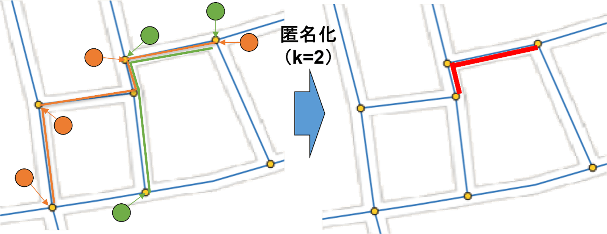
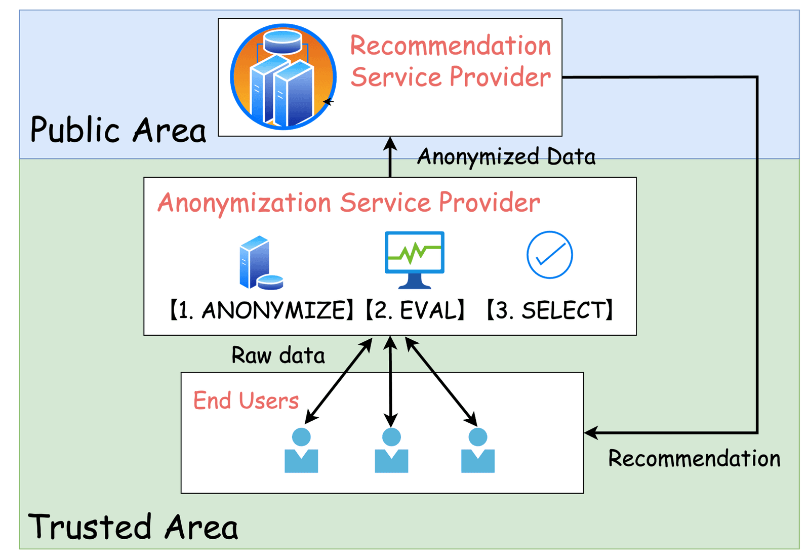
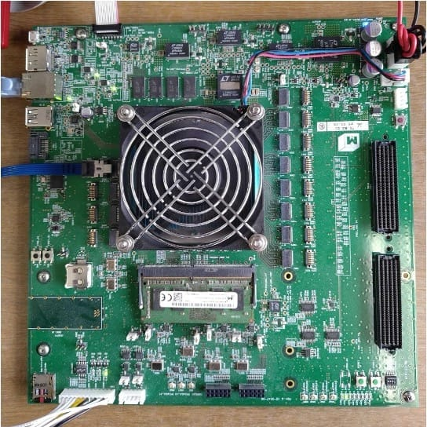

FPGAは回路構成を後から変更できるデバイスです。CPUは汎用性が高く、ASICは処理性能と電力効率に優れていますが、FPGAはその中間にあたります。CPUより並列処理に向き、ASICより柔軟に使えるため、エッジ領域のハードウェアアクセラレータとして注目されています。当研究室はエッジで求められる低遅延・低消費電力の処理を、FPGAによるハードウェア化で実現することを目指し、FPGAをネットワークの中で使う研究に取り組んでいます。対象は個人情報の匿名化に始まり、近年ではAIの推論にまで広がっています。

## ネットワーク内でのFPGA活用

回路を速くするだけではネットワークの中でFPGAを使えるようにはなりません。たとえば端末やサーバに手を加えずにデータを処理するには、通信経路上のFPGAが透過的に処理を担う必要があります。また動作中のFPGAの処理を別のFPGAへ移すときは、通信の整合性を保たなければなりません。当研究室はこうした技術を回路・ネットワーク・アプリケーションの各層にまたがって研究しています。回路の設計だけでなく、通信の流れやアプリケーションの要求まで含めて考えることが、ネットワークの中でFPGAを使いこなす前提になるためです。

## AIモデルのFPGA実装

深層ニューラルネットワークやグラフニューラルネットワーク、時系列予測モデルをFPGA上に実装し、応答速度と電力効率を高める研究をしています。処理内容に合わせた回路を構成できるため、ソフトウェアで実行するより遅延と消費電力を抑えられます。

具体的には、時空間圧縮を組み込んだDNNアクセラレータや、FPGAを機能単位で活用できるローコードのエッジ基盤などを研究しています。

## 匿名化機構の高速化

エッジやクラウドでデータを加工するときは、個人情報を守りながら処理を進める必要があります。当研究室は$k$-匿名性による経路匿名化、$m$-不変性による連続的に更新・公開されるビッグデータの保護、$k$-匿名性によってエッジ上で安全に情報を加工する映画リコメンドサービスなど、匿名化機構のFPGA実装に取り組んでいます。

匿名化機構をFPGAで動かすと、CPUより安定した処理時間と消費電力で、エッジやクラウド上のデータを安全に加工できます。

## 複数FPGAによる処理基盤

1枚のFPGAでは足りない処理には、複数のFPGAを組み合わせた基盤が必要です。当研究室はFPGAコンピューティングプラットフォーム「M-KUBOS」を活用し、MEC（Multi-access Edge Computing）向けの低遅延の処理基盤を構築しています。MECは利用者に近いエッジで処理を行う仕組みで、遅延を小さくすることが求められます。M-KUBOSによる基盤は、この要求に応えるためのものです。

