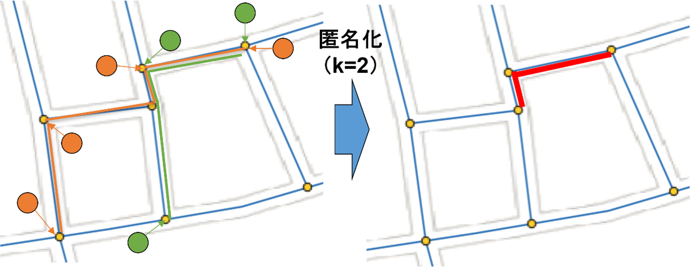
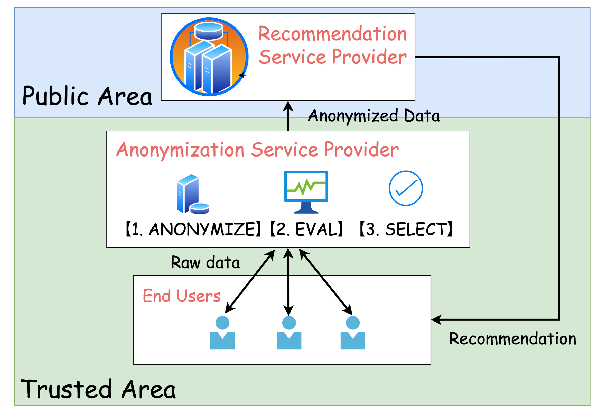
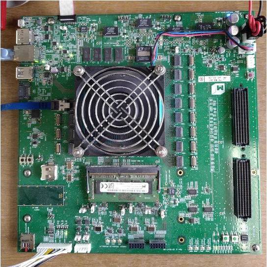

## FPGAによるAI・信号処理のハードウェアアクセラレーション

FPGAは**回路構成を後から変更できる**という特徴を持ち、CPUより並列処理に優れ、ASICより柔軟性が高いデバイスです。
CPUは汎用性、ASICは処理性能や電力効率に優れており、FPGAはその中間的な特徴を持ちます。
そのような特徴から、FPGAはエッジ領域でのハードウェアアクセラレータとして注目されています。エッジで求められる低遅延・低消費電力の処理を、FPGAを用いたハードウェア化によって実現します。
西研究室では、FPGAをネットワークの中で使う研究に取り組んでいます。近年では個人情報の匿名化からAIの推論にまで広がっています。
研究は回路を速くするだけでは終わりません。端末やサーバに手を加えずに、通信経路上のFPGAで透過的にデータを処理する。動作中のFPGAの処理を、通信の整合性を保ったまま別のFPGAへ移す。ネットワークの中でFPGAを使いこなすための技術を、回路・ネットワーク・アプリケーションにまたがって一通りそろえていることが、この研究室の特色です。

## AIモデルのFPGA実装

深層ニューラルネットワークやグラフニューラルネットワーク、時系列予測モデルをFPGA上に実装し、ソフトウェアでは到達し得ない応答速度と電力効率を追求しています。時空間圧縮を組み込んだDNNアクセラレータ、FPGAを機能単位で活用できるローコード・エッジ基盤など、AIの推論処理とハードウェアを融合させる研究に幅広く取り組んでいます。

## 匿名化機構のFPGA高速化

$k$-匿名性による経路匿名化、$m$-不変性による連続的に更新・公開されるビッグデータの保護、$l$-多様性によるエッジ上で安全に情報加工をする映画リコメンドサービスなど、匿名化機構のFPGA実装にも取り組んでいます。エッジやクラウド上での安全なデータ加工において、CPUより安定した処理時間、消費電力を実現しています。

## マルチFPGA基盤（MEC / FiC）

FPGAコンピューティングプラットフォーム「M-KUBOS」を活用し、MEC向けの低遅延処理基盤を構築しています。

