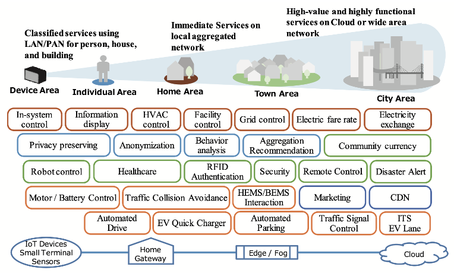
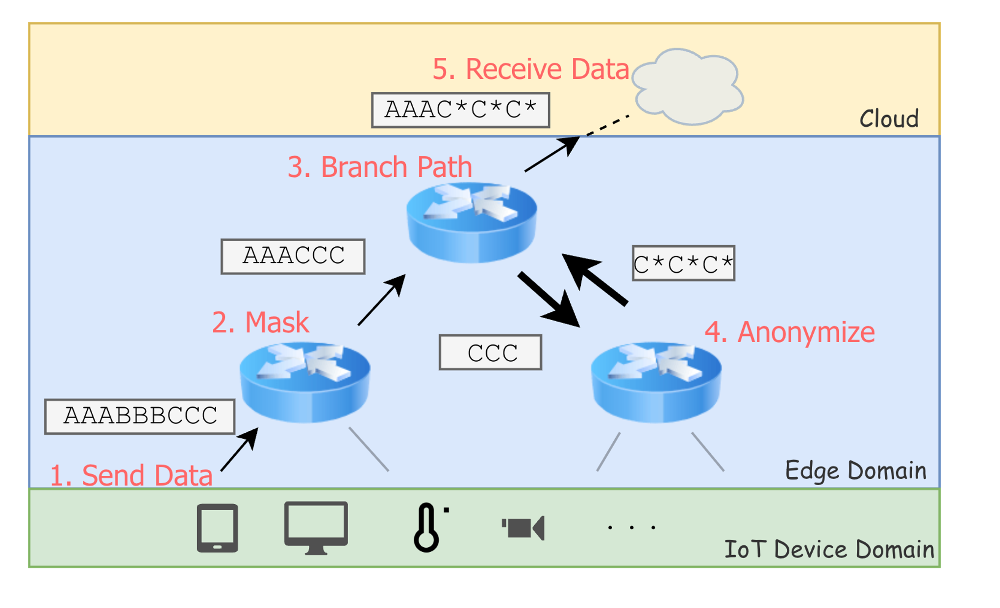

## スマートコミュニティを支えるエッジコンピューティング技術

近年、IoTデバイスから収集された多様なデータをクラウドへ送信し、処理・分析を行うことで多様なサービスを提供するスマートコミュニティの実現が進んでいます。当研究室では、クラウド処理の一部をデバイス近傍のエッジへ移譲する**エッジコンピューティング技術**に着目し、その高度化に向けた研究を行っています。

エッジ技術の活用により、リアルタイム性を求める処理の**低遅延化**や、**エッジ側でのデータ解析・書き換えによる高度な個人情報・プライバシー保護**を実現します。さらに、膨大かつ多種多様な既存のIoTデバイス側に対して一切の変更や機能追加を行うことなく、柔軟に新しいサービスを適用・提供できるシステムの構築を目指しています。

## ユーザ契約に基づくエッジ内コンテンツ加工と動的経路分岐

ユーザ契約に基づき、エッジ側で通信パケット内のコンテンツを自由に解析・書き換え（匿名化やマスキング）できる環境を構築します。エッジ領域内の計算リソース状況に応じてデータ経路を動的に分岐・迂回させることで、適切なノードへ透過的に処理を委託できるのが特徴です。これにより、複数サービスやユーザの情報が混在する環境でも、必要なデータのみを最適かつ安全に処理します。

## 暗号化通信に対応したクラウド・エッジ協調基盤

クラウドとエッジが鍵共有により連携することで、**暗号化された通信状態であっても**エッジ側でIoTデータへ安全にアクセス・復号できる仕組みを構築しています。これにより、暗号化通信の安全性を保ったまま、エッジ上での個人情報の匿名化やリアルタイムなフィルタリング・書き換えを実現します。
