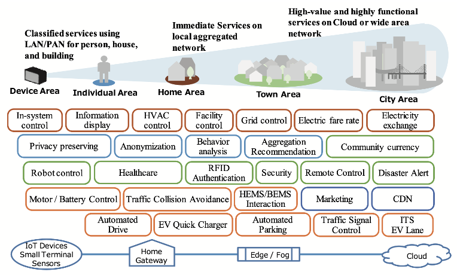
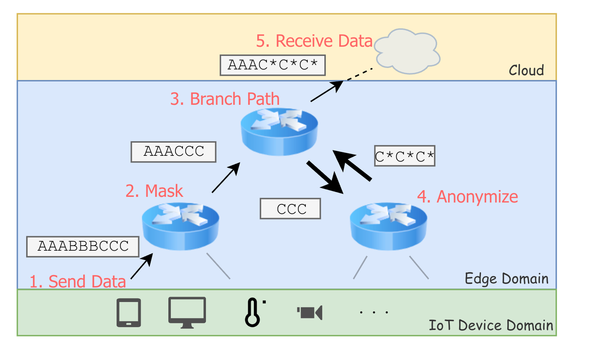

近年スマートコミュニティの実現が進んでいます。IoTデバイスが集めた多様なデータをクラウドへ送り、処理や分析を行うことで、さまざまなサービスを提供する取り組みです。当研究室はクラウドで行っている処理の一部をデバイスの近くにあるエッジへ移すエッジコンピューティングに着目し、その高度化に取り組んでいます。クラウドに到達するまでの経路上で処理を行いつつ、通信の透明性を保つことが、この研究の中心です。

## エッジコンピューティングが必要な理由

すべての処理をクラウドで行うと、データはデバイスからクラウドまでの経路を往復します。リアルタイム性が求められる処理では、この往復が遅延の原因になります。処理をデバイスに近いエッジで行えば、往復の時間を減らせるため、遅延を小さくできます。

また個人情報を含むデータがそのままクラウドへ届くことも課題です。エッジでデータを解析し、書き換えてから送れば、個人情報やプライバシーを守りながらサービスを提供できます。

もう一つの課題は、IoTデバイスの数が膨大で、種類も多様なことです。これらのデバイスを一つずつ改修して新しい機能を加えるのは負担が大きくなります。そこで当研究室は既存のデバイスに変更や機能追加を行わず、新しいサービスを柔軟に適用できるシステムを目指しています。デバイス側を変えずに済めば、すでに運用されている多くのデバイスをそのまま使い続けられます。

## 契約に基づくエッジ内の加工と動的な経路分岐

エッジで通信パケットの中身を解析・書き換えるには、誰のデータをどこまで扱ってよいかを決めておく必要があります。当研究室はユーザとの契約に基づいて、エッジ側でパケット内のコンテンツを匿名化やマスキングなどに自由に加工できる環境を構築しています。

エッジに処理が集中すると、特定のノードで計算資源が足りなくなるおそれがあります。そこでエッジ領域内の計算資源の状況に応じて、データの経路を動的に分岐させたり迂回させたりします。これにより処理を適切なノードへ透過的に委託できます。複数のサービスやユーザの情報が混在する環境でも、必要なデータだけを最適かつ安全に処理できます。

## 暗号化通信への対応

通信が暗号化されていると、エッジはパケットの中身を読めません。中身を読めなければ、匿名化もフィルタリングも書き換えもできず、エッジに処理を置く意味が薄れます。一方で安全のために行う暗号化をやめてしまえば、通信の安全性が損なわれます。エッジで処理することと、通信を安全に保つことの両立が課題になります。

そこで当研究室はクラウドとエッジが鍵を共有して連携する仕組みを構築しています。この仕組みでは暗号化された通信であっても、エッジがIoTデータへ安全にアクセスし、復号できます。暗号化通信の安全性を保ったまま、エッジ上での個人情報の匿名化や、リアルタイムなフィルタリング、書き換えが可能になります。
