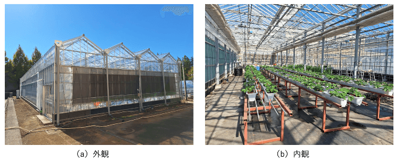
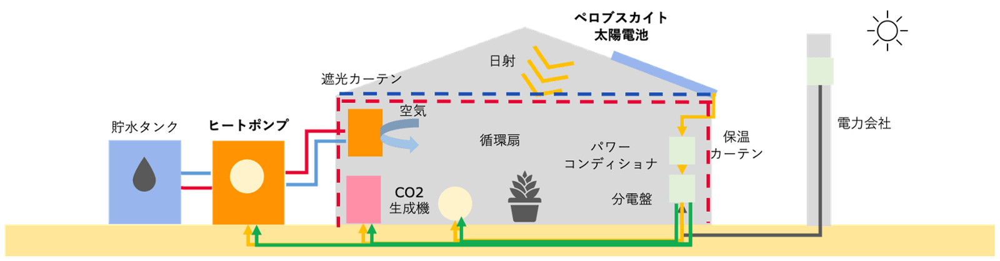

## スマートアグリカルチャー応用

当研究班では、IoTシステムを用いて温室内に構築したセンサネットワークの実データを活用し、次世代の施設園芸システムの構築を目指しています。近年は特に「デジタルツイン」の技術に注力しており、サイバー空間上で温室環境や作物の生育状態を再現・予測することで、エネルギー効率の最適化と作物の収量・品質の向上にアプローチする研究に取り組んでいます。

## ■ ZEG（net Zero Energy Greenhouse）の実現に向けた次世代型太陽光パネル連携温室に関する研究

温室の暖房システムが燃焼式から電気ヒートポンプへと移行する過渡期の現代において、施設園芸におけるエネルギー収支をゼロに近づける「ZEG」の達成が急務となっています。本研究では、必要な電気の需要分を温室内の発電で賄うシステムを目指し、壁面設置の太陽光パネルが作物の生育に与える影響の評価や、系統電力・蓄電池と連携したエネルギーマネジメントのシミュレーションをデジタルツイン上で実施しています。また、複雑な温室の物理モデルに依存せず、センシングデータのみを活用したデータドリブンなアプローチによる電力需要の時系列予測モデルの研究も行っています。

## ■ 温室内微気候分布による温室内作物の生育への影響の研究

温室内の温度や光には空間的なムラが存在し、これが光合成速度を規定して作物の収量や品質のばらつきに直結します。この微気候分布を再現・予測することで、最終的な収量や品質の分布までを予測できるデジタルツインの構築を目指しています。

- **連成シミュレータ構築と作物構造の考慮**
  精度の高い光合成予測には、微気候分布の再現だけでなく植物の形状（作物構造）の考慮が不可欠です。既知の生育ルールと温室全体の分布特徴から作物構造を生成・調整し、作物の構造レベルの微気候分布が果房生育に与える影響を評価する、環境と植物の連成シミュレータの構築を行っています。
- **葉温度の実測による高精度化**
  従来は環境データから複雑な計算で推定していた葉温度をセンサで直接測定し、デジタルツイン上の作物構造に直接反映させることで、光合成予測の精度とリアルタイム性を向上させる手法を研究しています。
- **データドリブンな生育分布予測**
  複雑な作物構造や温室のモデル化を介さず、大量のセンシングデータからダイレクトに温室全体の収量や品質の分布を予測する、AIベースの新たな予測モデルの構築も研究しています。
