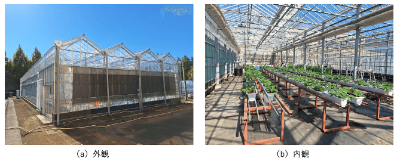
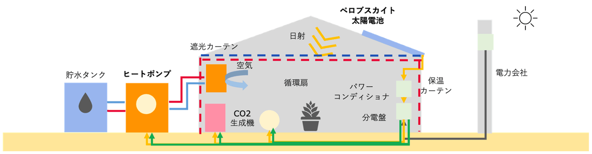

当研究室は農研機構などと連携し、IoTシステムで温室内に構築したセンサネットワークの実データを使って、次世代の施設園芸システムの構築を目指しています。近年は特に「デジタルツイン」の技術に力を入れています。サイバー空間上で温室環境や作物の生育状態を再現・予測し、エネルギー効率の最適化と、作物の収量・品質の向上につなげる研究です。

## 太陽光パネル連携温室とZEG

温室の暖房システムは燃焼式から電気ヒートポンプへ移る過渡期にあります。そのため、施設園芸のエネルギー収支をゼロに近づける ZEG（net Zero Energy Greenhouse）の達成が急がれています。当研究室は必要な電気を温室内の発電で賄うシステムを目指しています。壁面に設置した太陽光パネルが作物の生育に与える影響の評価と、系統電力・蓄電池と連携したエネルギーマネジメントのシミュレーションを、デジタルツイン上で行っています。

一方で温室の物理モデルは複雑です。そこで物理モデルに頼らず、センシングデータだけを使って電力需要を時系列で予測するデータ駆動型の手法も研究しています。

## 微気候分布と作物の生育

温室内の温度や光には空間的なムラがあります。このムラが光合成速度を左右し、作物の収量や品質のばらつきに直結します。当研究室は温室内の微気候分布を再現・予測し、最終的な収量や品質の分布まで予測できるデジタルツインの構築を目指しています。主な取り組みは次の3つです。

- 連成シミュレータの構築と作物構造の考慮：精度の高い光合成予測には、微気候分布の再現に加えて、植物の形状（作物構造）を考慮することが欠かせません。既知の生育ルールと温室全体の分布の特徴から作物構造を生成・調整し、作物の構造レベルの微気候分布が果房の生育に与える影響を評価します。環境と植物の連成シミュレータを構築しています。
- 葉温度の実測による高精度化：従来は環境データから複雑な計算で葉温度を推定していました。これをセンサで直接測定し、デジタルツイン上の作物構造に反映させることで、光合成予測の精度とリアルタイム性を高める手法を研究しています。
- データ駆動型の生育分布予測：複雑な作物構造や温室のモデル化を介さず、大量のセンシングデータから温室全体の収量や品質の分布を直接予測します。AIを使った新しい予測モデルの構築にも取り組んでいます。
